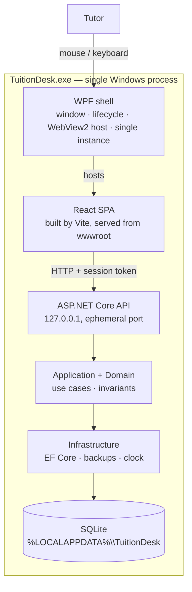

# TuitionDesk — Architecture

| Field | Value |
| --- | --- |
| Document | Technical architecture |
| Status | Draft v0.1 — for review |
| Date | 2026-11-08 |
| Scope | MVP (v0.1) |
| Related | [Product requirements](product.md) · [Roadmap](roadmap.md) |

---

## 1. Drivers and constraints

The architecture is shaped by these forces, in priority order:

| Rank | Driver | Consequence |
| --- | --- | --- |
| 1 | **Ship fast** | One process, one database, few moving parts, no infrastructure to operate |
| 2 | **Offline-first desktop** | All state on the local disk; no service dependency, no network calls |
| 3 | **Maintainable** | Clean dependency direction, explicit use cases, tests around rules, small files |
| 4 | **Declared stack** | React + TanStack Query frontend; .NET backend; SQLite; Clean Architecture |
| 5 | **Installable `.exe`** | Self-contained Windows build plus a per-user installer |
| 6 | **Solo-tutor scale** | Thousands of rows, one user, milliseconds of latency budget |

**Explicit simplicity guardrails.** To keep the Clean Architecture honest without gold-plating, v0.1 does **not** use: microservices, Docker, a message bus, MediatR pipeline behaviours, AutoMapper, generic repositories, domain events, event sourcing, a separate auth service, or a cloud database. Each omission is a decision, not an oversight; see §17 and the decision log in §3.

---

## 2. System shape

TuitionDesk ships as **one Windows process** containing two runtimes:

- a **WPF shell** (the `.exe`) that owns the window, lifecycle, and WebView2;
- an **ASP.NET Core minimal API** hosted in-process on a loopback port, backed by **SQLite**.

The **React SPA** is rendered by WebView2 and talks to the in-process API over HTTP on `127.0.0.1`. Static assets are served by the same API process, so the SPA and API share an origin. This keeps the frontend a normal React app (Vite dev server, `fetch`, TanStack Query) while avoiding a second process to install, supervise, or firewall.



**What is deliberately not in the picture:** no Electron, no Node.js runtime at install time, no background service, no ports opened beyond loopback, no browser window, no cloud.

---

## 3. Key decisions

| ID | Decision | Rationale | Revisit when |
| --- | --- | --- | --- |
| ADR-01 | **WPF + WebView2 shell** hosting the React SPA | Native window and lifecycle, small installer, WebView2 is present on Windows 11 and current Windows 10; keeps React exactly as a normal SPA | The shell needs deep OS integration WPF makes painful |
| ADR-02 | **In-process ASP.NET Core minimal API** on `127.0.0.1:0`, serving both API and SPA | One origin, no CORS, no second process, standard HTTP testing tools, same contract in dev and prod | The API must be shared by multiple clients or devices |
| ADR-03 | **Clean Architecture in 4 layers** (Domain, Application, Infrastructure, Server) plus a thin Desktop shell | The requested structure; keeps rules testable and EF out of use cases without a framework tax | Never — but keep layers pragmatic, not ceremonial |
| ADR-04 | **Explicit handlers, no MediatR** | ~15 use cases; a dispatcher and pipeline add indirection without paying for itself. Endpoint → validator → handler → repository is three readable hops | Cross-cutting behaviours multiply (auditing, caching, transactions everywhere) |
| ADR-05 | **EF Core + SQLite**, GUID primary keys, integer minor units for money | Migrations, LINQ, and strong typing; GUIDs give stable API/URL identities and ease future import/sync; avoids SQLite decimal quirks | Data outgrows SQLite or multi-user concurrency appears |
| ADR-06 | **Read models via query services, writes via repositories** | Lists need projections and counts, not aggregates; writes need invariants. Splitting avoids leaking `IQueryable` into Application | Query logic becomes complex enough to need its own layer |
| ADR-07 | **TanStack Query owns all server state**; no Redux/Zustand | Local API is fast; caching, invalidation, and loading states are exactly its job. UI state stays local or in the URL | Genuine cross-page client state appears |
| ADR-08 | **Feature folders on both sides** | A change to "students" touches one folder per layer; easier for one developer to hold in their head | Never |
| ADR-09 | **Archive over delete** | Prevents accidental data loss and keeps history; matches a tutor's mental model of "left" | A retention/GDPR requirement demands hard delete |
| ADR-10 | **Folder publish + Inno Setup per-user installer** | Reliable with WPF/WebView2 native binaries; no admin rights; small script to maintain. Single-file publish has native-loading caveats | MSIX/enterprise deployment is required |
| ADR-11 | **Loopback-only, token-guarded API** | Local hygiene against other processes and browser-based cross-origin probes; not a defence against a local attacker with file access | Real multi-user or remote access is added |
| ADR-12 | **No structured timetable in v0.1** | Free-text schedule ships faster and cannot be "wrong"; enrolments do not depend on time slots | Attendance or calendar features arrive |

---

## 4. Runtime model

### 4.1 Three run modes

| Mode | Frontend | Backend | Use |
| --- | --- | --- | --- |
| **A. Web dev** | `pnpm dev` (Vite, port 5173) | `dotnet run` (port 5179) | Day-to-day UI work in a browser; Vite proxies `/api` |
| **B. Desktop dev** | Vite (5173) loaded by WebView2 | `dotnet run` (5179) via proxy, or embedded | Verifying shell behaviour and window sizing |
| **C. Packaged** | Built assets in `wwwroot`, served by the embedded API | Embedded API on an ephemeral port | What the user installs |

In modes A and B, the server runs in `Development`, allows requests without a token, and Vite proxies `/api` to `127.0.0.1:5179`. In mode C, the server binds `127.0.0.1:0`, writes the chosen port into the URL, and requires the session token.

### 4.2 Startup sequence (packaged)

1. Acquire the single-instance mutex; if already held, show "TuitionDesk is already running", focus the existing window if possible, and exit.
2. Resolve the data directory (`%LOCALAPPDATA%\TuitionDesk`) and the database path; create folders if missing.
3. Open the SQLite connection; apply pragmas; run `PRAGMA quick_check`; if the file is corrupt, show a recovery dialog pointing at the backups folder instead of starting.
4. If the last backup is older than 24 hours, take one using SQLite's online backup API.
5. If migrations are pending, take a pre-migration backup, then apply them. On failure, stop with a dialog that names the backup and log file; never delete or recreate the database.
6. Generate a per-launch 256-bit session token.
7. Start the embedded server on `127.0.0.1:0`.
8. Create the WebView2 environment with a dedicated user-data folder; register the token/config injection script; navigate to `http://127.0.0.1:{port}/`.
9. Show the WPF window with a "Starting…" layer; reveal the SPA on `NavigationCompleted`; hide the layer once the shell has painted.
10. On close: stop the server gracefully, flush logs, dispose WebView2, release the mutex.

Startup failures surface as a native dialog with the message, the log path, and an "Open data folder" button — never a silent exit.

### 4.3 Port, token, and origin

- Bind **`127.0.0.1:0`**; read the actual address from `IServerAddressesFeature` after start. Ephemeral ports avoid collisions with other software.
- Use `127.0.0.1`, not `localhost`, to avoid IPv4/IPv6 resolution surprises; WebView2 treats loopback as a secure context.
- Generate a random token per launch and inject it into the page with `CoreWebView2.AddScriptToExecuteOnDocumentCreatedAsync`:

  ```js
  window.__TUITIONDESK__ = {
    apiBaseUrl: "http://127.0.0.1:54321",
    token: "…64 hex chars…",
    appVersion: "0.1.0"
  };
  ```

  The script runs before the SPA's own scripts, so the API client sees the config on first render. The dev server simply has no config and calls `/api` through the Vite proxy.
- API middleware requires `X-TuitionDesk-Token` on every `/api/*` request when `RequireToken` is on, compares in constant time, and rejects requests whose `Host` is not loopback or whose `Origin` is present and not the app origin.
- Static assets are served from `wwwroot` with SPA fallback for client routes. Unknown `/api/*` paths return JSON 404, not `index.html`.
- No CORS middleware: every legitimate request is same-origin.

**Threat model, stated plainly.** This protects against a random webpage in the user's browser probing `127.0.0.1` and against another local app making accidental calls. It does **not** protect the database from a local attacker who can read the user's files. That is accepted for a single-user local app; OS account security and BitLocker are the controls, and this is disclosed in the About panel.

### 4.4 Desktop shell responsibilities

| Concern | Behaviour |
| --- | --- |
| Window | Native chrome, 1280×800 default, 1024×700 minimum, size/position/maximised persisted (SHOULD) |
| WebView2 runtime | Detect with `CoreWebView2Environment.GetAvailableBrowserVersionString()`; if missing, show instructions and exit with a download link |
| User data folder | `%LOCALAPPDATA%\TuitionDesk\webview2` (never next to the `.exe`, which may be read-only) |
| Config injection | `AddScriptToExecuteOnDocumentCreatedAsync` with base URL, token, version |
| Navigation | Block `NewWindowRequested`; external links (none in v0.1) open in the default browser; block navigation away from the app origin |
| DevTools | Enabled in Debug, disabled in Release; context menu and status bar off in Release |
| Failures | `ProcessFailed` and unhandled exceptions show a native error dialog with log path; no silent white screen |
| Single instance | Per-user named mutex; second launch exits with a message |

### 4.5 Shutdown and data safety

- `OnClosing` cancels navigation, stops the server with a short timeout, flushes Serilog, and disposes the WebView2 environment.
- SQLite runs in WAL mode with `synchronous=FULL`: committed transactions survive a process kill and a power loss. At a few writes per minute, the extra fsync cost is irrelevant.
- A crash leaves the WAL file in place; SQLite recovers on next open. The pre-migration backup and daily backup are the recovery net.

---

## 5. Solution structure and dependency rules

```text
tuitiondesk/
├─ docs/
├─ src/
│  ├─ TuitionDesk.Domain/            # entities, value objects, enums, domain rules
│  ├─ TuitionDesk.Application/       # use cases, DTOs, validators, abstractions
│  ├─ TuitionDesk.Infrastructure/    # EF Core, SQLite, repositories, queries, backups
│  ├─ TuitionDesk.Server/            # ASP.NET Core minimal API, composition root
│  └─ TuitionDesk.Desktop/           # WPF shell, WebView2, embedded host bootstrap
├─ web/                              # React + Vite + TypeScript SPA
├─ tests/
│  ├─ TuitionDesk.Domain.Tests/
│  ├─ TuitionDesk.Application.Tests/
│  └─ TuitionDesk.Server.IntegrationTests/
├─ build/                            # publish.ps1, installer.iss, version props
├─ Directory.Build.props
├─ Directory.Packages.props
├─ global.json
└─ TuitionDesk.sln
```

| Project | SDK / TFM | Responsibility | References |
| --- | --- | --- | --- |
| `TuitionDesk.Domain` | `Microsoft.NET.Sdk`, `net10.0` | Entities, invariants, enums, domain exceptions. No EF, no ASP.NET, no I/O. | — |
| `TuitionDesk.Application` | `net10.0` | Commands/queries, handlers, DTOs, validators, `IClock`, `IUnitOfWork`, `ICounterService`, repository/query interfaces, application exceptions | Domain |
| `TuitionDesk.Infrastructure` | `net10.0` | `AppDbContext`, EF configuration, migrations, repository + query implementations, SQLite connection/pragmas, backup service, system clock, Serilog wiring | Application |
| `TuitionDesk.Server` | `Microsoft.NET.Sdk.Web`, `net10.0` | Minimal API endpoints, DI composition, exception → ProblemDetails, token middleware, static files, `ServerHost` entry point | Application, Infrastructure |
| `TuitionDesk.Desktop` | `Microsoft.NET.Sdk`, `net10.0-windows`, `UseWPF` | Window, WebView2, startup/shutdown, dialogs, mutex; calls `ServerHost.StartAsync` | Server |
| `web` | Vite + React + TS | SPA; consumes `/api` | — (HTTP only) |
| Tests | xUnit 2.9 | Domain rules, handlers, HTTP integration | Domain / Application / Server |

**Dependency rule:** dependencies point inward only. Domain knows nothing. Application knows Domain and its own abstractions. Infrastructure implements those abstractions. Server composes. Desktop composes the Server. The web app depends on nothing but the HTTP contract.

`Desktop → Server → Infrastructure → Application → Domain` is enforced by project references; a test can assert that Domain has no reference to EF Core or ASP.NET Core.

> **Build note:** `TuitionDesk.Desktop` is a WPF project referencing an ASP.NET Core project. Add an explicit `<FrameworkReference Include="Microsoft.AspNetCore.App" />` if the framework reference does not flow transitively, so the self-contained publish carries the ASP.NET Core runtime. Verify this during the M0 spike rather than discovering it at packaging time (see §16).

### 5.1 What lives where (and what must not)

| Layer | Belongs | Does not belong |
| --- | --- | --- |
| Domain | `Student`, `Class`, `Enrollment`, status enums, code generation rules, state transitions | EF attributes, DTOs, HTTP, logging, `DateTime.Now` |
| Application | `CreateStudentHandler`, `EnrollStudentHandler`, `StudentDto`, validators, query interfaces, transaction boundary | DbContext, SQL, ASP.NET types, WPF types |
| Infrastructure | `AppDbContext`, entity configurations, migrations, `StudentRepository`, `StudentQueries`, `SqliteBackupService`, `SystemClock` | Business rules beyond persistence mapping |
| Server | Endpoint mapping, request binding, validation filter, exception handler, token middleware, `ServerHost` | Business logic, direct SQL |
| Desktop | Window/lifecycle, WebView2, mutex, native dialogs | Business logic, data access |
| Web | Components, routes, query hooks, forms, formatting | Business rules that the server must also enforce |

---

## 6. Request flow example: enrol a student

```text
React (class detail)              POST /api/classes/{id}/enrollments {studentId}
  └─ useEnrollStudent mutation
       └─ fetch + token header
            └─ EnrollmentsEndpoint
                 ├─ binds request, model validation (shape only)
                 ├─ EnrollStudentValidator (FluentValidation) → 400 ProblemDetails
                 ├─ EnrollStudentHandler
                 │    ├─ IStudentRepository.GetByIdAsync        → Student (404 if missing)
                 │    ├─ IClassRepository.GetWithEnrollmentsAsync → Class (404 if missing)
                 │    ├─ student.EnsureCanEnroll()               → domain exception (409)
                 │    ├─ klass.EnsureCanEnroll(today)            → domain exception (409)
                 │    ├─ duplicate active check + capacity check
                 │    ├─ Enrollment.Create(...)                  → domain validates
                 │    └─ IUnitOfWork.SaveChangesAsync            → single transaction
                 └─ 201 Created + EnrollmentDto
       └─ onSuccess: invalidate class, roster, classes list, student, students list
```

One HTTP round trip, one database transaction, no background work.

---

## 7. Domain model

### 7.1 Entities

```mermaid
erDiagram
    STUDENT ||--o{ ENROLLMENT : "attends via"
    CLASS ||--o{ ENROLLMENT : "has roster"

    STUDENT {
        text Id PK
        text StudentCode UK
        text FullName
        text Phone
        text Email
        date DateOfBirth
        text GuardianName
        text GuardianPhone
        text School
        text GradeLevel
        date JoinedOn
        text Notes
        int Status
        datetime CreatedAtUtc
        datetime UpdatedAtUtc
    }

    CLASS {
        text Id PK
        text ClassCode UK
        text Name
        text Subject
        text GradeLevel
        text ScheduleText
        date StartDate
        date EndDate
        int MonthlyFeeMinor
        text Currency
        int Capacity
        text Notes
        int Status
        datetime CreatedAtUtc
        datetime UpdatedAtUtc
    }

    ENROLLMENT {
        text Id PK
        text StudentId FK
        text ClassId FK
        date EnrolledOn
        int Status
        date WithdrawnOn
        text Notes
        datetime CreatedAtUtc
        datetime UpdatedAtUtc
    }
```

### 7.2 Invariants and behaviour

**Student**

- `FullName` trimmed, 2–120, must contain at least one letter.
- `Phone` 7–20, digits plus `+ - ( ) space`; stored as entered (trimmed).
- `Email` optional, valid when present.
- `DateOfBirth`, if set, not in the future.
- `JoinedOn` not in the future.
- `Archive(clock)` sets `Archived` and yields the active enrolments the caller must withdraw; `Restore()` returns `Active`.
- Archived students are read-only: mutating methods throw `DomainException` until restored.

**Class**

- `Name`, `Subject` required; `StartDate` required; `EndDate >= StartDate` when present.
- `MonthlyFeeMinor >= 0`; `Currency` 3-letter ISO code, default `LKR`.
- `Capacity` null (unlimited) or ≥ 1.
- `Archive()` sets `Archived` and yields active enrolments for withdrawal; `Restore()` returns to `Active`.
- Archived classes cannot accept enrolments and are read-only.

**Enrollment**

- `EnrolledOn` is today or earlier.
- `Withdraw(clock)` only from `Active`, sets status and date; a second attempt throws.
- Re-enrolment creates a new row; the old row stays `Withdrawn`.

Domain exceptions are translated to HTTP status codes by the server (see §10.6). Business decisions that need to read other aggregates (e.g. duplicate active enrolment) live in the application handler, with the database unique index as the final guard.

### 7.3 Enumerations

| Enum | Values | Storage |
| --- | --- | --- |
| `StudentStatus` | `Active = 0`, `Archived = 1` | `INTEGER` |
| `ClassStatus` | `Active = 0`, `Archived = 1` | `INTEGER` |
| `EnrollmentStatus` | `Active = 0`, `Withdrawn = 1` | `INTEGER` |

Numeric values are part of the database contract; explicit numbers prevent accidental reordering.

### 7.4 Schema (generated by EF Core migrations; DDL shown for reference)

```sql
PRAGMA journal_mode = WAL;
PRAGMA synchronous = FULL;
PRAGMA foreign_keys = ON;

CREATE TABLE "Students" (
    "Id"             TEXT NOT NULL CONSTRAINT "PK_Students" PRIMARY KEY,
    "StudentCode"    TEXT NOT NULL,
    "FullName"       TEXT NOT NULL,
    "Phone"          TEXT NOT NULL,
    "Email"          TEXT NULL,
    "GuardianName"   TEXT NULL,
    "GuardianPhone"  TEXT NULL,
    "DateOfBirth"    TEXT NULL,
    "School"         TEXT NULL,
    "GradeLevel"     TEXT NULL,
    "JoinedOn"       TEXT NOT NULL,
    "Notes"          TEXT NULL,
    "Status"         INTEGER NOT NULL,
    "CreatedAtUtc"   TEXT NOT NULL,
    "UpdatedAtUtc"   TEXT NOT NULL
);
CREATE UNIQUE INDEX "IX_Students_StudentCode" ON "Students" ("StudentCode");
CREATE INDEX "IX_Students_FullName" ON "Students" ("FullName");
CREATE INDEX "IX_Students_Phone"    ON "Students" ("Phone");
CREATE INDEX "IX_Students_Status"   ON "Students" ("Status");

CREATE TABLE "Classes" (
    "Id"               TEXT NOT NULL CONSTRAINT "PK_Classes" PRIMARY KEY,
    "ClassCode"        TEXT NOT NULL,
    "Name"             TEXT NOT NULL,
    "Subject"          TEXT NOT NULL,
    "GradeLevel"       TEXT NULL,
    "ScheduleText"     TEXT NULL,
    "StartDate"        TEXT NOT NULL,
    "EndDate"          TEXT NULL,
    "MonthlyFeeMinor"  INTEGER NOT NULL,
    "Currency"         TEXT NOT NULL,
    "Capacity"         INTEGER NULL,
    "Notes"            TEXT NULL,
    "Status"           INTEGER NOT NULL,
    "CreatedAtUtc"     TEXT NOT NULL,
    "UpdatedAtUtc"     TEXT NOT NULL
);
CREATE UNIQUE INDEX "IX_Classes_ClassCode" ON "Classes" ("ClassCode");
CREATE INDEX "IX_Classes_Subject"  ON "Classes" ("Subject");
CREATE INDEX "IX_Classes_Status"   ON "Classes" ("Status");

CREATE TABLE "Enrollments" (
    "Id"            TEXT NOT NULL CONSTRAINT "PK_Enrollments" PRIMARY KEY,
    "StudentId"     TEXT NOT NULL REFERENCES "Students" ("Id") ON DELETE RESTRICT,
    "ClassId"       TEXT NOT NULL REFERENCES "Classes"  ("Id") ON DELETE RESTRICT,
    "EnrolledOn"    TEXT NOT NULL,
    "Status"        INTEGER NOT NULL,
    "WithdrawnOn"   TEXT NULL,
    "Notes"         TEXT NULL,
    "CreatedAtUtc"  TEXT NOT NULL,
    "UpdatedAtUtc"  TEXT NOT NULL
);
-- One active enrolment per student/class pair; history stays unconstrained.
CREATE UNIQUE INDEX "UX_Enrollments_Active"
    ON "Enrollments" ("StudentId", "ClassId") WHERE "Status" = 0;
CREATE INDEX "IX_Enrollments_ClassId_Status"   ON "Enrollments" ("ClassId", "Status");
CREATE INDEX "IX_Enrollments_StudentId_Status" ON "Enrollments" ("StudentId", "Status");

CREATE TABLE "Counters" (
    "Key"       TEXT NOT NULL CONSTRAINT "PK_Counters" PRIMARY KEY,
    "NextValue" INTEGER NOT NULL
);
```

**Why `Counters`:** student and class codes must be sequential and never reused. A one-row-per-prefix counter updated in the same transaction as the insert is simpler and safer than parsing `MAX(Code)`.

### 7.5 Persistence conventions

| Concern | Convention |
| --- | --- |
| Primary keys | `Guid` (`Guid.CreateVersion7()`), stored as `TEXT` by EF Core SQLite |
| Dates (no time) | `DateOnly`, stored as `TEXT` `yyyy-MM-dd` |
| Audit timestamps | `DateTimeOffset` via `IClock.UtcNow`, stored as ISO 8601 text, displayed in local time |
| Money | `long` minor units + `string Currency`; never `float`/`double`; formatting only in the UI |
| Enums | Stored as `INTEGER` with explicit values |
| Strings | Trimmed at the edge; max lengths enforced by EF configuration and validators |
| Nulls | Optional data is nullable; empty strings are normalised to `null` |
| Concurrency | None in v0.1 (single process). `UpdatedAtUtc` exists for diagnostics |
| Deletes | No hard deletes exposed; FKs are `RESTRICT` so an accidental delete fails loudly |
| Case-insensitive search | `LIKE` on lower-cased input; SQLite `NOCASE` covers ASCII. FTS5 is a later improvement for Unicode names |

---

## 8. Application layer

### 8.1 Use case catalogue

| Area | Use case | Kind |
| --- | --- | --- |
| Students | `SearchStudents` | Query |
| | `GetStudent` (includes enrolments) | Query |
| | `CreateStudent` | Command |
| | `UpdateStudent` | Command |
| | `ArchiveStudent` (withdraws enrolments) | Command |
| | `RestoreStudent` | Command |
| Classes | `SearchClasses` | Query |
| | `GetClass` (counts) | Query |
| | `GetClassRoster` | Query |
| | `CreateClass` | Command |
| | `UpdateClass` | Command |
| | `ArchiveClass` (withdraws enrolments) | Command |
| | `RestoreClass` | Command |
| Enrolments | `EnrollStudent` | Command |
| | `EnrollStudents` (bulk, all-or-nothing) | Command |
| | `WithdrawEnrollment` | Command |
| Reference | `GetLookups` (subjects, grade levels) | Query |
| System | `GetHealth` | Query |

### 8.2 Handler pattern

- One class per use case, `sealed`, constructor-injected dependencies, a single `HandleAsync(command, ct)` method returning a DTO or `void`.
- Handlers live next to their request/response records in feature folders:

  ```text
  Application/
    Students/
      CreateStudent.cs        # command + validator + handler
      UpdateStudent.cs
      ArchiveStudent.cs
      SearchStudents.cs
      GetStudent.cs
    Classes/
    Enrollments/
    Abstractions/             # repositories, query services, IClock, IUnitOfWork
    Common/                   # PagedResult<T>, exceptions, validation helpers
  ```

- Endpoints bind HTTP DTOs → command → call handler → map result. No handler knows about HTTP.
- Validation runs in a minimal-API endpoint filter (`FluentValidation`), collecting all failures into a `400` ProblemDetails with a field → messages map. Domain invariants stay in entities and throw `DomainException`.
- Mapping is manual extension methods (`ToDto`, `ToListItem`); no AutoMapper, no reflection surprises.
- Transactions: a handler performs at most one `SaveChangesAsync`, which is atomic. Multi-entity operations (archive student + withdraw enrolments) mutate the loaded aggregate graph and save once.
- Duplicate active enrolment is checked in the handler and guaranteed by the partial unique index; a `DbUpdateException` on that index maps to `409`.

### 8.3 Error model

| Exception | HTTP | When |
| --- | --- | --- |
| `ValidationException` | 400 | Invalid input shape or values |
| `NotFoundException` | 404 | Unknown student/class/enrolment |
| `ConflictException` | 409 | Duplicate active enrolment, archived target, already withdrawn |
| `DomainException` | 400 | Invariant violation (defensive; normally pre-empted) |
| Unhandled | 500 | Logged with trace ID; generic message returned |

All errors use RFC 7807 ProblemDetails plus a stable `code` extension for client branching and a `traceId` that matches the log entry.

### 8.4 Pagination

`PagedResult<T>` with `Items`, `Page`, `PageSize`, `TotalCount`, `TotalPages`. Defaults: page 1, page size 25, max 100. Invalid paging clamps rather than errors. Counts are computed with a separate `CountAsync` over the same filter; both run against indexed columns.

---

## 9. Infrastructure

### 9.1 EF Core setup

- `AppDbContext` with `DbSet<Student>`, `DbSet<Class>`, `DbSet<Enrollment>`, `DbSet<Counter>`.
- `IEntityTypeConfiguration` per entity; explicit table/column names, max lengths, enum conversions, `DateOnly`/`DateTimeOffset` handling, and the filtered unique index:

  ```csharp
  builder.HasIndex(e => new { e.StudentId, e.ClassId })
         .HasFilter("\"Status\" = 0")
         .IsUnique();
  ```

- Connection string built at startup from the resolved data directory:

  ```text
  Data Source=C:\Users\<user>\AppData\Local\TuitionDesk\data\tuitiondesk.db;
  Foreign Keys=True;Default Timeout=5;Pooling=True
  ```

- Pragmas on open: `journal_mode=WAL`, `synchronous=FULL`, `busy_timeout=5000`, `foreign_keys=ON`.
- `DbContext` is scoped per HTTP request; repositories are scoped; `IClock` and `SqliteBackupService` are singletons.
- Design-time factory (`IDesignTimeDbContextFactory<AppDbContext>`) honours `TUITIONDESK_DATA_DIR` so `dotnet ef` commands never touch real user data.

### 9.2 Repositories and query services

| Abstraction | Implementation notes |
| --- | --- |
| `IStudentRepository` | `GetByIdAsync`, `AddAsync`; aggregate-level reads for writes |
| `IClassRepository` | `GetByIdAsync`, `GetWithEnrollmentsAsync`, `AddAsync` |
| `IEnrollmentRepository` | `GetByIdAsync`, `AddAsync` |
| `ICounterService` | Allocates the next sequential student/class code inside the write transaction, using the `Counters` row |
| `IStudentQueries` | `SearchAsync(filter)` and `GetDetailAsync(id)` returning DTOs with class counts/enrolments via projection, `AsNoTracking` |
| `IClassQueries` | `SearchAsync`, `GetDetailAsync`, `GetRosterAsync` (paged, searchable, active/withdrawn), `CountActiveAsync` |
| `ILookupQueries` | Distinct subjects and grade levels from `Classes`/`Students` |
| `IUnitOfWork` | `SaveChangesAsync(ct)` over the scoped `DbContext` |

Query services return **application DTOs**, not domain entities or `IQueryable`. This keeps EF out of the web layer and prevents accidental N+1s: list queries project counts with a correlated subquery or grouped join in a single SQL statement.

### 9.3 Migrations and seeding

- Migrations live in `TuitionDesk.Infrastructure/Persistence/Migrations`.
- At startup: take a pre-migration backup when `GetPendingMigrationsAsync()` returns anything, then `MigrateAsync()`. EF's migrations history table provides the schema version reported in About and `/api/health`.
- If migration fails: log, keep the previous file, show a dialog pointing at the backup and logs; do not delete or "recreate" the database.
- No seed data in production. A `--seed-demo` developer flag inserts a few students and classes into a throwaway database; never into the user's file.

### 9.4 Backups

- `SqliteBackupService` opens a source connection and uses `SqliteConnection.BackupDatabase` to write a consistent copy — no copying a live WAL by hand.
- Triggers: before any migration; once per app start if the newest backup is older than 24 hours; manual "Back up now" from About (SHOULD).
- Naming: `tuitiondesk-20261108-214500.db` in `data/backups`; retention: keep the newest 10 plus any pre-migration backup.
- Restore is manual in v0.1: close the app, replace the database file with a backup (documented in About and the README). Automatic restore-after-corruption is a roadmap item.

### 9.5 Clock, IDs, and logging

- `IClock` (`SystemClock` in production, `FakeClock` in tests) supplies UTC now and local today. No handler calls `DateTime.Now`.
- IDs are generated in domain factories with `Guid.CreateVersion7()` so inserts stay index-friendly.
- Serilog: console sink in Development; rolling file sink in production at `%LOCALAPPDATA%\TuitionDesk\logs\tuitiondesk-.log`, daily, 7 files retained, shared, 10 MB cap. Request logging at `Information`, EF commands at `Warning`, unhandled exceptions at `Error` with a correlation ID.
- Logs redact phone numbers and emails (keep last 2 digits / domain only).

---

## 10. API

### 10.1 Conventions

- JSON, camelCase, `System.Text.Json`; `DateOnly` as `yyyy-MM-dd`; money as `monthlyFeeMinor` + `currency`; timestamps as ISO 8601 with offset.
- Errors: `application/problem+json` with `code` and `traceId`.
- No API version segment: the SPA and API ship together, and integration tests pin the contract. (If a second client ever appears, introduce `/api/v1` then.)
- All endpoints are `async`, accept `CancellationToken`, and use `AsNoTracking` for reads.
- OpenAPI is exposed in Development only (`/openapi/v1.json`), for exploration and optional type generation.

### 10.2 Endpoints

| Method | Path | Purpose | Success | Errors |
| --- | --- | --- | --- | --- |
| GET | `/api/health` | Liveness, version, schema version | 200 | 500 |
| GET | `/api/lookups` | Distinct subjects and grade levels | 200 | — |
| GET | `/api/students` | Paged student search (supports `excludeClassId`) | 200 | 400 |
| POST | `/api/students` | Create student | 201 + `Location` | 400, 409 |
| GET | `/api/students/{id}` | Student detail with enrolments | 200 | 404 |
| PUT | `/api/students/{id}` | Update student | 200 | 400, 404, 409 |
| POST | `/api/students/{id}/archive` | Archive + withdraw enrolments | 200 | 404, 409 |
| POST | `/api/students/{id}/restore` | Restore archived student | 200 | 404, 409 |
| GET | `/api/classes` | Paged class search (supports `excludeStudentId`) | 200 | 400 |
| POST | `/api/classes` | Create class | 201 + `Location` | 400 |
| GET | `/api/classes/{id}` | Class detail with counts | 200 | 404 |
| PUT | `/api/classes/{id}` | Update class | 200 | 400, 404 |
| POST | `/api/classes/{id}/archive` | Archive + withdraw enrolments | 200 | 404, 409 |
| POST | `/api/classes/{id}/restore` | Restore archived class | 200 | 404, 409 |
| GET | `/api/classes/{id}/roster` | Paged roster; status active, withdrawn, or all | 200 | 404 |
| POST | `/api/classes/{id}/enrollments` | Enrol one student | 201 | 400, 404, 409 |
| POST | `/api/classes/{id}/enrollments/bulk` | Enrol many, all-or-nothing | 201 | 400, 404, 409 |
| POST | `/api/enrollments/{id}/withdraw` | Withdraw enrolment | 200 | 404, 409 |

**Query parameters**

| Endpoint | Parameters |
| --- | --- |
| `GET /api/students` | `search`, `status` (`active`, `archived`, `all`; default `active`), `sort` (`name`, `recent`, `code`; default `name`), `excludeClassId` (omit students actively enrolled in that class), `page`, `pageSize` |
| `GET /api/classes` | `search`, `status`, `subject`, `excludeStudentId`, `sort` (`name`, `recent`, `code`), `page`, `pageSize` |
| `GET /api/classes/{id}/roster` | `search`, `status` (`active`, `withdrawn`, `all`; default `active`), `sort` (`name`), `page`, `pageSize` |

### 10.3 Core DTOs

```jsonc
// StudentListItem
{ "id": "0193f2…", "code": "STU-00042", "fullName": "Kasun Perera",
  "phone": "+94 77 123 4567", "gradeLevel": "Grade 10",
  "status": "active", "activeClassCount": 2, "updatedAt": "2026-11-08T16:12:00Z" }

// StudentDetail (enrolments included, active first)
{ "id": "0193f2…", "code": "STU-00042", "fullName": "Kasun Perera",
  "phone": "+94 77 123 4567", "email": "kasun@example.com",
  "guardianName": "Nimal Perera", "guardianPhone": "+94 71 555 1234",
  "dateOfBirth": "2009-04-18", "school": "Ananda College",
  "gradeLevel": "Grade 10", "joinedOn": "2026-01-10", "notes": null,
  "status": "active",
  "enrollments": [
    { "id": "0193f3…", "classId": "0193e1…", "className": "Grade 10 Mathematics",
      "subject": "Mathematics", "scheduleText": "Wed 4–6pm", "enrolledOn": "2026-01-12",
      "status": "active", "withdrawnOn": null }
  ] }

// ClassDetail
{ "id": "0193e1…", "code": "CLS-0001", "name": "Grade 10 Mathematics",
  "subject": "Mathematics", "gradeLevel": "Grade 10",
  "scheduleText": "Wed 4–6pm, Sat 9–11am", "startDate": "2026-01-10",
  "endDate": null, "monthlyFeeMinor": 400000, "currency": "LKR",
  "capacity": 15, "activeEnrollmentCount": 12, "status": "active" }

// RosterItem
{ "enrollmentId": "0193f4…", "studentId": "0193f2…", "studentCode": "STU-00042",
  "fullName": "Kasun Perera", "phone": "+94 77 123 4567",
  "gradeLevel": "Grade 10", "enrolledOn": "2026-01-12",
  "status": "active", "studentStatus": "active" }
```

`code` is display/identity sugar; all links and API calls use `id`.

### 10.4 Examples

```http
POST /api/classes/0193e1.../enrollments
Content-Type: application/json
X-TuitionDesk-Token: …

{ "studentId": "0193f2...", "enrolledOn": "2026-11-08" }
```

```http
HTTP/1.1 201 Created
Location: /api/enrollments/0193f4...

{ "id": "0193f4...", "studentId": "0193f2...", "classId": "0193e1...",
  "enrolledOn": "2026-11-08", "status": "active", "withdrawnOn": null }
```

### 10.5 Duplicate acknowledgement

Non-blocking duplicate warnings need a round trip without saving twice:

- `POST /api/students` and `PUT /api/students/{id}` accept `acknowledgeDuplicate` (default `false`). If an active student with the same name and phone exists and the flag is false, the API returns `409` with code `student.duplicate_warning` and an `existing` array of `{ id, code, fullName }`. The dialog offers "Open existing" or "Save anyway"; the latter retries with `acknowledgeDuplicate: true`.
- Class create/update uses the same pattern for name + subject + schedule (`class.duplicate_warning`, SHOULD).
- Bulk enrolment validates every student first; on any conflict it returns `409` with a `conflicts` array and writes nothing.

### 10.6 Error responses

```jsonc
// 400 validation
{
  "type": "https://tuitiondesk.local/errors/validation",
  "title": "One or more validation errors occurred.",
  "status": 400,
  "code": "validation_failed",
  "errors": {
    "phone": ["Phone is required."],
    "email": ["Enter a valid email address."]
  },
  "traceId": "00-8f2c…-01"
}

// 409 conflict
{
  "type": "https://tuitiondesk.local/errors/conflict",
  "title": "Enrolment conflict",
  "status": 409,
  "detail": "Kasun Perera is already enrolled in Grade 10 Mathematics.",
  "code": "enrollment.already_active",
  "traceId": "00-8f2c…-01"
}
```

Codes used by the SPA: `validation_failed`, `student.not_found`, `class.not_found`, `enrollment.not_found`, `student.archived`, `class.archived`, `enrollment.already_active`, `enrollment.already_withdrawn`, `student.duplicate_warning` (informational), `class.duplicate_warning`, `database.busy`.

---

## 11. Frontend architecture

### 11.1 Stack

| Concern | Choice | Notes |
| --- | --- | --- |
| Runtime/build | Node 24 LTS, pnpm 10, Vite 8 | Native ESM, fast HMR; Rolldown/Oxc bundling |
| UI | React 19 + TypeScript 5.9 (strict) | No class components |
| Server state | **TanStack Query 5** | All API reads/writes; no global store |
| Routing | React Router 7 (`createBrowserRouter`) | Route objects, lazy pages, `errorElement` |
| Forms | React Hook Form 7 + Zod 4 (`@hookform/resolvers`) | Shared schemas per feature; server errors mapped back |
| Styling | Tailwind CSS 4 + shadcn/ui (Radix primitives) | Accessible dialogs/selects; components live in the repo |
| Toasts | Sonner | `aria-live` friendly |
| Dates | `date-fns` + `Intl` | Format only; no date math on the client |
| Tests | Vitest + React Testing Library + MSW | Component/hook level |
| Quality | ESLint 9 flat config, Prettier, `tsc --noEmit` | CI gate |

Deliberately absent: Redux/Zustand, Axios, TanStack Table, CSS-in-JS, a component library runtime (MUI/Chakra). Native `fetch` with a typed wrapper covers this API surface.

### 11.2 Folder structure

```text
web/src/
├─ app/
│  ├─ main.tsx              # providers, query client, router
│  ├─ router.tsx
│  ├─ AppShell.tsx          # sidebar, header, outlet
│  └─ NotFound.tsx
├─ features/
│  ├─ students/
│  │  ├─ api.ts             # endpoints + types
│  │  ├─ queries.ts         # queryOptions, hooks, mutations
│  │  ├─ schemas.ts         # Zod schemas
│  │  ├─ components/        # StudentForm, StudentCard, …
│  │  └─ pages/             # StudentsListPage, StudentDetailPage, StudentFormPage
│  ├─ classes/              # same shape
│  └─ enrollments/
│     ├─ api.ts
│     ├─ mutations.ts
│     └─ components/        # AddStudentsDialog, EnrollStudentDialog, WithdrawButton
├─ shared/
│  ├─ api/client.ts         # fetch wrapper, config, ApiError, ProblemDetails mapping
│  ├─ api/types.ts          # PagedResult, ProblemDetails
│  ├─ components/ui/        # shadcn/ui primitives
│  ├─ components/           # DataTable, EmptyState, PageHeader, ConfirmDialog, Money, StatusBadge
│  ├─ hooks/                # useDebouncedValue, useListParams, useUnsavedChanges
│  └─ lib/                  # queryKeys, formatters, cn()
├─ styles/tailwind.css
└─ test/                    # MSW handlers, render helpers
```

### 11.3 Routing

| Route | Page |
| --- | --- |
| `/` | Redirect to `/students` |
| `/students` | Students list |
| `/students/new` | Student form |
| `/students/:id` | Student detail |
| `/students/:id/edit` | Student form |
| `/classes` | Classes list |
| `/classes/new` | Class form |
| `/classes/:id` | Class detail with roster |
| `/classes/:id/edit` | Class form |
| `/about` | About / diagnostics |
| `*` | Not found |

List state (`search`, `status`, `page`, `sort`) lives in `useSearchParams`, so the back button and reloads behave correctly. Form routes use `useBlocker` for the dirty-form guard.

### 11.4 Server state and invalidation

```ts
export const queryKeys = {
  students: { all: ['students'] as const,
              list: (f: StudentFilters) => ['students', 'list', f] as const,
              detail: (id: string) => ['students', 'detail', id] as const },
  classes:  { all: ['classes'] as const,
              list: (f: ClassFilters) => ['classes', 'list', f] as const,
              detail: (id: string) => ['classes', 'detail', id] as const,
              roster: (id: string, f: RosterFilters) => ['classes', id, 'roster', f] as const },
  lookups: ['lookups'] as const,
  health: ['health'] as const,
};
```

Invalidation is intentionally broad — the API is local and cheap, and correctness beats micro-optimisation:

| Mutation | Invalidates |
| --- | --- |
| Create/update/archive/restore student | `['students']`, `['lookups']`, `['classes']` (counts) |
| Create/update/archive/restore class | `['classes']`, `['lookups']`, `['students']` (class counts) |
| Enrol (single or bulk) | `['classes']`, `['students']`, `['lookups']` |
| Withdraw | `['classes']`, `['students']` |

Query client defaults: `retry` only for network/5xx up to 2 attempts, `staleTime: 2_000`, `refetchOnWindowFocus: false` (desktop app), `throwOnError: false`, mutations `retry: 0`.

Mutations are **not** optimistic in v0.1: the local API answers in single-digit milliseconds and a server rejection (duplicate, capacity, archived) must not leave the UI lying. Pending states disable the action and show a spinner in the button.

### 11.5 Data fetching contract

`shared/api/client.ts`:

- reads `window.__TUITIONDESK__` when present, otherwise uses `/api` (Vite proxy);
- adds `X-TuitionDesk-Token` when present;
- parses ProblemDetails into a typed `ApiError` (`status`, `code`, `title`, `detail`, `errors`);
- maps network failures to a friendly `LocalServiceUnavailableError`;
- accepts `AbortSignal` from TanStack Query.

Errors surface as: field errors inside forms, toasts for action failures, and an inline retry panel for page-level load failures. A 404 on a detail page renders "Not found" with a link back to the list rather than a crash.

### 11.6 Lists, forms, and components

- `DataTable`: accessible `<table>`, sortable headers, row actions, skeleton rows, empty state, pagination control. Server-side sorting/paging only.
- `useListParams`: debounces search (250 ms), resets page on filter change, keeps the URL as the source of truth.
- `StudentForm` / `ClassForm`: Zod schema mirrors the server rules; RHF `mode: 'onBlur'`; on 400, map `errors` to fields and focus the first invalid one; disable Save while pending; confirm on cancel when dirty.
- `MoneyInput`: edits a decimal string, submits integer minor units; display uses `Intl.NumberFormat` with the class currency.
- `CapacityBadge`: `12 / 15`, `Full`, or `Unlimited`; text plus icon, not colour alone.
- `ConfirmDialog` names the object and the consequence ("Archiving Kasun Perera will withdraw them from Grade 10 Mathematics and Physics.").
- Dialogs are Radix-based: focus trap, Escape closes (except while saving), labelled titles.

### 11.7 Accessibility and performance

- Every input has a `<label>`; errors use `aria-describedby` and `aria-invalid`; form submit focuses the first error.
- Tables have caption/headers; row actions are buttons with accessible names ("Withdraw Kasun Perera from Grade 10 Mathematics").
- Focus returns to the trigger after a dialog closes; toasts are polite live regions.
- Keyboard: Tab order follows visual order; Escape dismisses dialogs; Enter submits forms.
- Bundle: route-level `lazy` for form/detail pages; the base bundle stays small; no icon library beyond a small inline set.
- Network: no polling; no prefetching sprees; lists fetch on navigation with cached filters.

---

## 12. Cross-cutting concerns

| Concern | Approach |
| --- | --- |
| Configuration | `appsettings.json` (host, logging) + environment variables. No user-editable config in v0.1. `TUITIONDESK_DATA_DIR` overrides the data folder for dev/tests |
| Secrets | None. The session token is generated per launch and never persisted |
| Logging | Serilog as in §9.5; request IDs propagated into ProblemDetails |
| Error handling | Typed exceptions → `IExceptionHandler` → ProblemDetails; WPF-level handlers for startup and WebView2 failures; React error boundary + query error states |
| Time | Store UTC; `IClock` for "today" in local time; display local dates; no timezone picker in v0.1 |
| Money | Integer minor units end-to-end; format at the edge; currency per class |
| Validation | Zod on the client for fast feedback; FluentValidation on the server as the authority; domain invariants as the last line |
| Security | Loopback binding, per-launch token, host/origin checks, CSP `default-src 'self'`, no remote content, DevTools off in Release, no outbound calls |
| Privacy | No telemetry; logs redacted; About panel explains where data lives |
| Accessibility | WCAG 2.1 AA for core flows; Radix primitives; keyboard paths tested manually |
| i18n | English only; all strings in code for now; dates/numbers via `Intl` so future localisation is not a rewrite |
| Diagnostics | About panel: version, schema version, data/log folder, backup count, copy-diagnostics |

---

## 13. Testing strategy

| Level | Scope | Tools | Must cover |
| --- | --- | --- | --- |
| Domain unit | Invariants and transitions | xUnit, built-in asserts | Name/phone validation, archive/restore, enrolment withdrawal, date rules, code formatting |
| API integration | Use cases and HTTP contract against real SQLite | xUnit + `ServerHost.StartAsync` on an ephemeral loopback port + temp DB | Student/class CRUD, duplicate enrolment, archived targets, bulk all-or-nothing, archive cascading withdrawals, token enforcement, roster filters |
| Frontend unit | Schemas and formatters | Vitest (node) | Validation messages, money conversion, date formatting |
| Manual smoke | Packaged app | Checklist in roadmap | Install, core flows offline, upgrade, uninstall |

Rules of thumb:

- Prefer a small number of high-value tests over coverage theatre. Every business rule in `product.md` has at least one test.
- Integration tests run the real embedded host on `127.0.0.1:0` with a unique temp data directory. This exercises migrations, EF Core, middleware, and the HTTP contract together.
- `TuitionDesk.Server` exposes `public partial class Program`; each integration test disposes the server and removes its temp directory.
- No UI snapshot tests. Test behaviour and accessible roles.
- CI (optional; see M4) runs `dotnet build`, `dotnet test`, `pnpm lint`, `pnpm typecheck`, `pnpm test`.

FluentAssertions v8+ has commercial licensing terms; the suite deliberately uses xUnit's built-in assertions instead.

---

## 14. Build, packaging, and distribution

### 14.1 Build pipeline

```text
build/publish.ps1
  1. pnpm --dir web install --frozen-lockfile
  2. pnpm --dir web build                  → web/dist
  3. dotnet publish src/TuitionDesk.Desktop -c Release -r win-x64 \
       --self-contained true -o artifacts/app
  4. web/dist → artifacts/app/wwwroot (Desktop content include)
  5. iscc build/installer.iss              → artifacts/TuitionDesk-Setup-0.1.0.exe
```

Step 5 is skipped with a warning when Inno Setup is not installed (`build/publish.ps1 -SkipInstaller`).

- **Self-contained** publish so the machine needs no .NET installation. Trade-off: ~150–200 MB installed, ~60–80 MB compressed installer.
- **Folder publish**, not single-file: WebView2's native loader and WPF satellite resources are more reliable as files. The user only ever sees the installer.
- Trimming and NativeAOT are off (WPF + reflection); ReadyToRun is optional after startup is measured.
- Version comes from `Directory.Build.props` (`VersionPrefix`) and is injected into the assembly, the installer, `/api/health`, and `VITE_APP_VERSION`.

### 14.2 Installer (Inno Setup 6)

| Setting | Value |
| --- | --- |
| Output | `TuitionDesk-Setup-{version}.exe` |
| Privileges | `lowest` — per-user, no UAC |
| Install dir | `{localappdata}\Programs\TuitionDesk` |
| Shortcuts | Start Menu (always), desktop (optional task) |
| WebView2 | Detect the Evergreen runtime; warn with install instructions when missing (the app itself also refuses to start without it) |
| Uninstall | Removes program files and shortcuts; **keeps** `%LOCALAPPDATA%\TuitionDesk` (restore it manually from the backups folder if needed) |
| Upgrade | Installing over an existing version replaces binaries; data and schema migrate on first launch |
| Signing | Unsigned in v0.1 → SmartScreen warning documented. Code signing is a v1.0 task |

The WebView2 Evergreen runtime is machine-wide and preinstalled on Windows 11 and current Windows 10. For a fully offline install on a machine without it, bundle the Evergreen **standalone** installer (~150 MB) as an optional variant rather than the default.

### 14.3 Data locations

| Item | Path |
| --- | --- |
| Database | `%LOCALAPPDATA%\TuitionDesk\data\tuitiondesk.db` (+ `-wal`, `-shm`) |
| Backups | `%LOCALAPPDATA%\TuitionDesk\data\backups\` |
| Logs | `%LOCALAPPDATA%\TuitionDesk\logs\` |
| WebView2 profile | `%LOCALAPPDATA%\TuitionDesk\webview2\` |
| Window state | `%LOCALAPPDATA%\TuitionDesk\window.json` (SHOULD) |

`%LOCALAPPDATA%` (not `%APPDATA%`) because the data is machine-specific, can be large, and must not roam.

### 14.4 Upgrade and rollback

- Forward-only EF migrations; each release ships every migration needed from any prior version.
- Before migrating: backup, then migrate in a transaction where SQLite allows. If migration fails, the app refuses to start against the half-migrated file and points at the backup.
- Rollback = uninstall the new version, reinstall the previous one, and restore the pre-migration backup if the schema changed. Documented in the release notes.
- Auto-update (Velopack or similar) is a v1.0 candidate, not v0.1.

---

## 15. Operational concerns

| Scenario | Behaviour |
| --- | --- |
| Database locked / busy | 5 s busy timeout; after that, `database.busy` → UI "The app is busy, try again" |
| Corrupt database | `quick_check` fails at startup → dialog explaining recovery, with "Open backups folder"; no automatic overwrite |
| Disk full | Save fails with a clear message; log the error; existing data untouched |
| App killed | WAL recovery on next start; no partial relation because each save is one transaction |
| Second instance | Mutex → message + exit; no second writer |
| WebView2 missing | Native dialog with install instructions; app exits cleanly |
| WebView2 process crash | `ProcessFailed` → offer reload; log it |
| Unhandled server exception | 500 + trace ID; logged with the same ID; UI shows a retry |
| Antivirus blocks installer | Documented SmartScreen/AV note; signing later |

---

## 16. Risks and mitigations

| Risk | Likelihood | Impact | Mitigation |
| --- | --- | --- | --- |
| WebView2 packaging/runtime surprises on target machines | Medium | High | Spike in M0; test on a clean VM early; runtime detection dialog with install instructions |
| Kestrel-in-WPF project/publish issues (framework reference, native DLLs) | Medium | High | Validate in M0 with a throwaway spike before feature work; folder publish |
| Scope creep into fees/attendance | High | Medium | Product non-goals + roadmap cut lines; fee data only in v0.1 |
| SQLite decimal/GUID/date pitfalls | Medium | Medium | Explicit conventions (§7.5), integration tests on a real file |
| Migration breaks user data | Low | High | Pre-migration backup, forward-only migrations, upgrade test in release checklist |
| SmartScreen/AV blocks unsigned installer | High | Medium | Document workaround; code signing before broader distribution |
| Loopback port or token mishaps | Low | Medium | Ephemeral port, retry, integration test for token enforcement |
| Sole developer bus factor | Medium | High | Docs, tests around rules, simple stack, no exotic dependencies |
| Data loss from user copying the DB while running | Low | Medium | About panel explains backup/restore; WAL files included in instructions |

---

## 17. Rejected alternatives

| Alternative | Why rejected |
| --- | --- |
| **Electron + .NET sidecar** | Two runtimes, two installers, IPC, larger footprint, more moving parts for the same result |
| **Tauri** | Excellent footprint, but the backend would be Rust or a sidecar; conflicts with the required .NET backend |
| **Blazor Hybrid / MAUI** | Would drop React, which is a hard requirement; MAUI's Windows tooling adds friction |
| **WPF-only UI** | Contradicts the React requirement and slows UI iteration |
| **Local server + browser tab** | Not a desktop app; no window lifecycle, no single-instance control, user must manage a URL |
| **HostObject / WebMessage bridge instead of HTTP** | Requires a bespoke RPC layer, loses standard HTTP tooling and TanStack Query's natural fit, complicates testing |
| **SQL Server / PostgreSQL** | Requires a service, installation, and admin rights; SQLite is sufficient at this scale |
| **Single-file publish** | Native WebView2 loader and WPF resource extraction caveats; installer hides the folder anyway |
| **MediatR / full CQRS framework** | Indirection without benefit at 15 use cases; explicit handlers are easier to trace |
| **Generic repository + AutoMapper** | Leaky, reflection-heavy, and hides the queries that matter for list performance |

---

## 18. How this evolves

| Future feature | Where it lands without a rewrite |
| --- | --- |
| Fees and payments | New `Payment`/`Charge` entities referencing `Enrollment` or `Student`; class already has fee + currency |
| Attendance | `AttendanceRecord` referencing `Enrollment`; class already has a schedule text and date range |
| Structured timetable | `ClassSlot` child table; enrolment and roster untouched |
| Teachers | `Teacher` entity + `TeacherId` on `Class`; single-tutor default back-filled |
| CSV import/export | Application handlers + a mapping UI; no schema change |
| Search improvements | FTS5 virtual table or a normalised search column; query services isolate it |
| Multi-user / cloud | The API already exists; replace SQLite with a server DB, add auth, and the SPA (or a second client) reuses the contract. GUID keys keep merges sane |
| Auto-update | Velopack around the same folder publish |

The two decisions that would be most expensive to reverse are the single-process hosting model (ADR-01/02) and the local-only trust model (ADR-11). Everything else is additive.

---

## 19. Appendices

### A. Repository conventions

- Trunk-based: short-lived branches, conventional commits (`feat:`, `fix:`, `docs:`, `chore:`).
- `Directory.Build.props`: nullable enabled, implicit usings, warnings as errors, deterministic builds, version.
- `Directory.Packages.props`: central package versions; no floating versions.
- `global.json`: pin SDK `10.0.x`, `rollForward: latestFeature`.
- Formatting: `dotnet format` and Prettier; CI fails on unformatted code.
- Every PR (even solo) runs build + tests before merge.

### B. Version matrix

| Component | Version |
| --- | --- |
| .NET | 10 (LTS) |
| C# | 14 |
| EF Core | 10 |
| ASP.NET Core | 10 |
| WPF / WebView2 | .NET 10 / WebView2 Evergreen |
| Node | 24 LTS |
| React | 19 |
| TypeScript | 5.9 |
| Vite | 8 |
| TanStack Query | 5 |
| Tailwind CSS | 4 |
| SQLitePCLRaw (native SQLite) | 2.1.14 |
| xUnit | 2.9 |
| Inno Setup | 6 |
| SQLite | bundled with EF Core provider (3.4x) |

Exact patch versions are pinned in `Directory.Packages.props` and `pnpm-lock.yaml`.

### C. Definition of a good endpoint

1. Binds a request record; no domain entity in the signature.
2. Runs a FluentValidation validator through the shared endpoint filter.
3. Calls exactly one handler.
4. Returns a DTO or `Results.Created/CreatedAtRoute`, `NoContent`, or a typed ProblemDetails.
5. Uses `ct` everywhere, with no `Task.Result` or `.Wait()`.
6. Has at least one integration test covering success and the main failure.

### D. Definition of a good use case

1. One public `HandleAsync` method, constructor injection, no service locator.
2. Loads only the aggregates it needs; no `IQueryable` leaking.
3. Enforces the product rules, calling domain methods rather than setting state directly.
4. Saves once; returns a DTO, not an entity.
5. Has a test for the happy path and each business-rule rejection.

---

*This document and [product.md](product.md) must stay consistent; a change to scope or a core decision updates both.*
